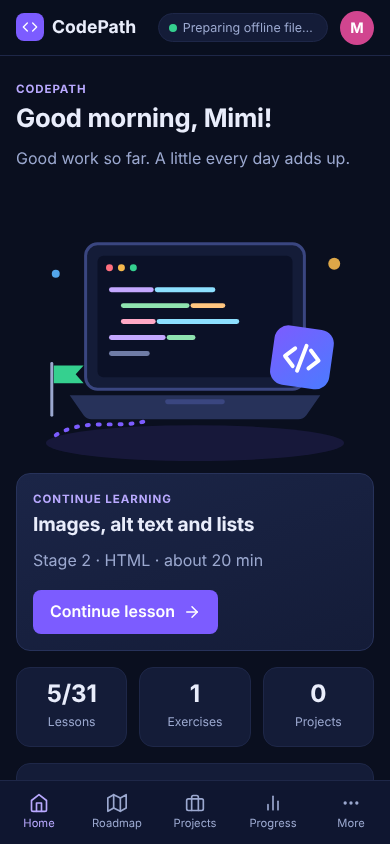
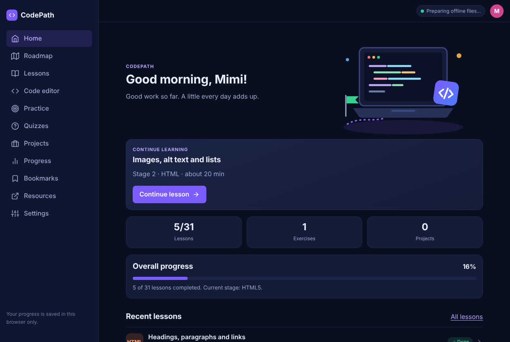

# CrydenCode

A personal, offline-first web development learning platform for one learner. It teaches HTML, CSS and JavaScript from zero, and is built with plain HTML5, CSS3 and vanilla JavaScript. There is no backend, no database, no build step and no framework.

## Why it exists

Many beginners learn on a phone because they do not have a computer. CrydenCode is a small learning platform built for that: short lessons, a phone-friendly code editor with a live preview, exercises that really check the code, quizzes and projects. It saves progress on the device, works offline, and installs like a normal app. No accounts, no backend, no frameworks.

- 12 main pages plus a Resources page and an offline fallback page
- 31 lessons across 6 stages, 13 checked practice exercises, 4 quizzes (23 questions), 7 projects
- A code editor and a separate sandboxed live-preview page
- Progress, bookmarks, quiz scores and editor drafts saved in the browser (`localStorage`)
- Works offline after the first visit (service worker + Cache API) and can be installed as an app (PWA)
- A real "Download website ZIP" button that builds a ZIP in the browser with no dependencies

## Screenshots

Mobile and desktop screenshots are in `docs/screenshots/` (not part of the in-browser ZIP).

 

## Run it locally

Service workers do **not** work from `file://`. Use any static server on `localhost`:

```bash
cd crydencode
python3 -m http.server 8080      # or: npx serve .
```

Open <http://localhost:8080>. `localhost` counts as a secure context, so offline caching and install work there.

The pages themselves also open directly from the folder (double-click `index.html`), but then offline caching, install and the ZIP button are unavailable.

## Use it offline and install it

1. Open the site over HTTPS (or `localhost`) once while online.
2. Watch the status label (top right, and on the Home page). It says **Preparing offline files…** while the service worker saves every file, then **Offline-ready** only after all files are confirmed saved. If something fails it shows an error instead.
3. Turn off the internet and reload. All lessons, the editor, practice, quizzes and projects still work. External links and the Weather project need internet.
4. To install: use the **Install as an app** button on Home (shown when the browser offers it), or the browser menu. On iPhone/iPad use Share → Add to Home Screen.

### Install vs ZIP

- **Install** saves the site inside the browser so it opens like an app, offline. Needs HTTPS or localhost.
- **Download website ZIP** is a copy of the source files (HTML, CSS, JS, images, `sw.js`, README, LICENSE) to keep, edit or publish yourself. It does not include learner progress. The ZIP is created in the browser by `assets/js/offline.js` (a small "stored" ZIP writer with CRC-32), so it needs no library. It fetches each file listed in `assets/js/files.js`, so it works from a server, not from `file://`.

## Learner data

Everything is stored in the current browser on the current device: one versioned object under `crydencode:v1`, the editor draft under `crydencode:v1:draft`, and separate storage for code run inside the preview.

- There is no login. The "profile" is only a display name and avatar colour.
- Clearing browser data, private windows and switching browsers can remove progress.
- **Settings → Export** saves a JSON backup; **Import** validates the file (app name, schema version, shapes and sizes) before showing a confirmation. Unknown or malformed fields are dropped, so a broken file cannot crash the app.
- **Settings → Reset** needs you to type `RESET`.

## Deploy (HTTPS)

Any static host works. For GitHub Pages:

1. Create a repository and push the contents of this folder to the root of the default branch.
2. Repository → Settings → Pages → *Deploy from a branch* → choose the branch and `/ (root)`.
3. Open `https://YOUR-NAME.github.io/REPOSITORY/`. Changes can take several minutes to appear (see the GitHub Pages quickstart).

All paths in the project are relative, so it works in a sub-folder.

### Releasing an update

Change `version` in `assets/js/files.js`. The service worker uses it in the cache name, installs the new files, and deletes older caches on activate. Add any new file to the lists in `files.js` so it is cached and included in the ZIP.

## Project structure

```
crydencode/
├── index.html … settings.html     one HTML file per page (same shell)
├── offline.html                   shown for uncached pages when offline
├── manifest.json, sw.js
├── assets/
│   ├── css/styles.css             design tokens, layout, components, light/dark
│   ├── images/                    local SVG art and PNG icons
│   └── js/
│       ├── files.js               list of all files (service worker + ZIP)
│       ├── theme-init.js          applies saved theme before first paint
│       ├── storage.js             versioned localStorage, validation, import/export
│       ├── data.js                stages, projects, resource links
│       ├── lessons.js, lessons-2.js   lesson content
│       ├── practice-data.js       exercises (with checks) and quiz questions
│       ├── app.js                 DOM helper, icons, navigation shell, progress maths
│       ├── offline.js             service worker registration, status, install, ZIP
│       ├── pages-learn.js         home, roadmap, lessons, lesson, bookmarks, resources
│       ├── pages-practice.js      practice, quiz, projects
│       ├── pages-more.js          progress, settings
│       ├── editor.js, preview.js  editor page and sandboxed preview
├── README.md
└── LICENSE
```

## How it works (short)

- **No unsafe DOM injection.** Pages are built with a small `h(tag, attrs, ...children)` helper that uses `createElement` and `textContent`; there is no `innerHTML` and no inline event handler anywhere.
- **Editor → Preview.** The editor saves the draft to `localStorage` and opens `preview.html`. The preview builds one HTML document and loads it into `<iframe sandbox="allow-scripts allow-modals allow-forms">` (no `allow-same-origin`), so learner code cannot touch CrydenCode's own storage or DOM. A small script inside the frame forwards `console` output and provides a separate `localStorage` for the learner's code. This is a learning sandbox, **not** a production security boundary.
- **Practice checks are real.** HTML/CSS exercises render the code in a script-less iframe and test the resulting DOM and computed styles. JavaScript exercises run in a sandboxed iframe and evaluate test expressions against the learner's functions, with a 3-second timeout.
- **Progress is calculated, never faked.** Every percentage on Home and Progress comes from saved lessons, exercises, quizzes and project checklists.

## Content and sources

Roadmap and lessons were written for this project and informed by MDN Learn web development and the MDN Curriculum, web.dev Learn, WCAG 2.2, the Pro Git book, the GitHub Pages quickstart, and MDN/web.dev service worker guidance. Links and a "last reviewed" date are on the Resources page (last reviewed 27 October 2026). Tools, plan limits and browser support change, so check official sources. The Weather project uses Open-Meteo (no key for non-commercial use, CC BY 4.0 attribution; needs internet).

## Limitations

- Offline caching and install need HTTPS or `localhost` (not `file://`).
- Progress cannot sync between devices automatically; use Export/Import.
- The editor is a plain accessible `<textarea>`, not a full code editor (no live syntax colouring while typing). Code samples in lessons are highlighted.
- Study time estimates are rough.
- Public API projects depend on a third-party service and an internet connection.
- Browser storage can be cleared by the browser or by the learner.

## Testing checklist

Tested in Chromium (phone and desktop sizes): every page loads without errors or horizontal overflow; lesson completion, bookmarks, filters, editor drafts, preview isolation, quizzes, all 13 checked exercises (starter fails, solution passes), project checklists, theme and text size, export/import (including hostile files), corrupt-data recovery and reset; service worker caches all 40 files, every page reloads offline, offline fallback page, and the downloaded ZIP is valid and byte-identical to the source. Re-run by serving the folder and opening each page. Other browsers and real phones were not tested.

## Licence

MIT. See `LICENSE`.
